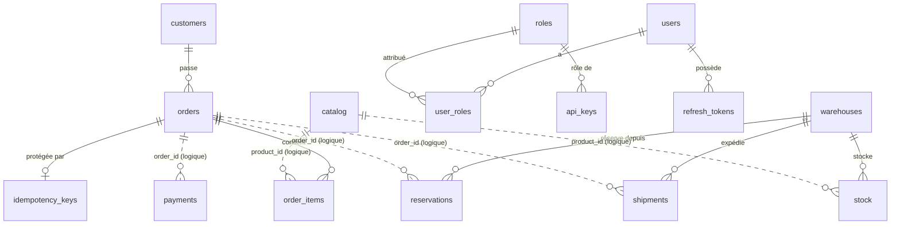

# Modèle de données KMarket

Ce document explique **pourquoi** les données sont organisées ainsi. Le détail des colonnes et des contraintes est dans les scripts, qui font foi :

| Partie | Script |
|---|---|
| Schémas | [`db/postgres/01_schemas.sql`](../db/postgres/01_schemas.sql) |
| `orders` (service Commandes) | [`db/postgres/02_orders.sql`](../db/postgres/02_orders.sql) |
| `inventory` (service Stock) | [`db/postgres/03_inventory.sql`](../db/postgres/03_inventory.sql) |
| `payments` (service Paiement) | [`db/postgres/04_payments.sql`](../db/postgres/04_payments.sql) |
| `auth` (service Auth) | [`db/postgres/05_auth.sql`](../db/postgres/05_auth.sql) |
| Partitions | [`db/postgres/06_partitions.sql`](../db/postgres/06_partitions.sql) |
| Index | [`db/postgres/07_indexes.sql`](../db/postgres/07_indexes.sql) |
| Rôles PostgreSQL | [`db/postgres/08_roles.sh`](../db/postgres/08_roles.sh) |
| `catalog` (service Catalogue, MongoDB) | [`db/mongo/01_catalog.js`](../db/mongo/01_catalog.js) |

Les décisions citées (D1 à D6) sont dans [`decisions.md`](decisions.md), les écarts au schéma du sujet dans l'[ADR-008](adr/008-ecarts-schema-reference.md).

## Principes

- **Un service, ses données.** Un serveur PostgreSQL, un schéma et un rôle par service (`orders_svc`, `inventory_svc`, `payments_svc`, `auth_svc`), plus MongoDB pour le catalogue (`catalog_svc`). Chaque rôle reçoit `permission denied` sur les schémas des autres. Pour une donnée d'un autre service, on appelle son API.
- **Pas de clé étrangère entre services.** `product_id` et `order_id` sont des liens logiques, vérifiés par le code.
- **Montants en centimes** (`INTEGER`) dans les deux bases : pas d'erreur d'arrondi.
- **Dates en `TIMESTAMPTZ`** (stockées en UTC).
- **Clients ≠ utilisateurs** : `orders.customers` sont les clients du site, `auth.users` l'équipe Market.
- **Rôles PostgreSQL ≠ rôles applicatifs** : les premiers protègent les tables, les seconds (`auth.roles`) protègent les API.

Trait plein : clé étrangère SQL. Pointillés : lien logique vérifié par le code.

## Choix non évidents

| Où | Choix | Pourquoi |
|---|---|---|
| `orders.orders` | PK `(id, created_at)` | Table partitionnée : PostgreSQL impose que la PK contienne la colonne de partition |
| `orders.order_items` | `order_created_at` recopiée | Nécessaire pour la FK composite vers `orders` ; la ligne tombe dans la même partition que sa commande |
| `orders.order_items` | `unit_price_cents` | Prix figé au moment de la commande : un changement de prix du catalogue ne modifie pas le passé |
| `orders.idempotency_keys` | Table séparée, non partitionnée | Sur `orders`, on ne pourrait poser que `UNIQUE (clé, created_at)` : deux envois de la même demande ont des dates différentes, le doublon passerait |
| `payments.payments` | Non partitionnée | Pour garder `UNIQUE (idempotency_key)` : un paiement rejoué ne débite jamais deux fois |
| `inventory.stock` | `CHECK (quantity >= 0)` | La survente est impossible, même avec des requêtes simultanées |
| `inventory.reservations` | `UNIQUE (order_id, product_id, warehouse_id)` | `/reserve` rejoué ne décrémente pas deux fois ; `/release` sait exactement quoi rendre |
| `inventory.shipments` | Dans le schéma du service Stock | Ce sont les entrepôts qui expédient |
| `inventory.warehouses` | `capacity_units > 0` | Diviseur du taux de remplissage (`SUM(stock) / capacité`, alerte au-dessus de 90 %) |
| `auth` | bcrypt pour les mots de passe, SHA-256 pour les clés d'API et refresh tokens | bcrypt est lent exprès (résiste au brute-force) ; une clé aléatoire longue n'en a pas besoin |
| `catalog` | Validator `oneOf` par catégorie | Schéma souple mais contrôlé : un Livre sans ISBN est refusé (D1) |
| `catalog` | Catégorie `Beaute` sans accent | Les codes servent aussi d'enum GraphQL, qui n'accepte pas « é » ; le front affiche « Beauté » |
| `catalog` | `product_id` via la collection `counters` | Clé attribuée par l'application ; l'index unique reste le garde-fou |

## Liens logiques entre services

| Lien | Vérifié par | Comment |
|---|---|---|
| `order_items.product_id` → `catalog.product_id` | Commandes | Appel au Catalogue (prix) avant de créer la commande |
| `stock.product_id` → `catalog.product_id` | Catalogue | Création du produit puis `POST /stock` ; produit annulé si le stock échoue |
| `reservations.order_id`, `shipments.order_id` → `orders.id` | Commandes | C'est Commandes qui appelle `/reserve` et `/release` |
| `payments.order_id` → `orders.id` | Commandes | C'est Commandes qui appelle `POST /payments` |

Un produit déjà commandé ne se supprime pas, il s'archive (`status: inactive`). Pour le savoir, le Catalogue interroge le service Commandes ; il ne lit jamais `order_items`.

## Cycle de vie d'une commande

L'état d'une commande est réparti sur trois services. Ce tableau donne la combinaison attendue à chaque étape.

| Statut commande (D2) | Réservations | Paiement | Livraison |
|---|---|---|---|
| `pending` | — | — | — |
| `stock_reserved` | `reserved` | `pending` | — |
| `paid` | `committed` | `succeeded` | — |
| `preparing` | `committed` | `succeeded` | `preparing` |
| `shipped` | `committed` | `succeeded` | `shipped` |
| `delivered` | `committed` | `succeeded` | `delivered` |
| `payment_failed` | `released` | `failed` | — |
| `cancelled` | `released` | `refunded` | — |

Saga orchestrée par le service Commandes : `pending`, réservation du stock, `stock_reserved`, paiement, `paid`. Si le paiement est refusé (par exemple au-dessus de 200 €), la réservation est libérée et la commande passe en `payment_failed`.

## Partitionnement

- `orders.orders` et `orders.order_items` sont découpées par mois (`orders_2026_11`, …).
- La fonction `orders.ensure_monthly_partitions(début, fin)` crée les partitions manquantes : 12 mois passés et 12 à venir à l'initialisation ; le seed l'appelle pour couvrir son historique. Seul l'administrateur peut l'exécuter.
- Une partition `DEFAULT` recueille les dates hors plage. Si elle contient des lignes d'un mois, la création de la partition de ce mois échoue tant qu'on ne les a pas déplacées.
- **Bénéfice** : une requête filtrée par date ne lit que les partitions concernées (*partition pruning*). **Coût** : `GET /v1/orders/{id}` sans date interroge l'index de chaque partition.

## Index

Les clés primaires et contraintes `UNIQUE` ont déjà leur index. Les autres, avec la requête qu'ils servent :

| Index | Requête servie |
|---|---|
| `orders (customer_id)` | Historique d'un client (requête de la démo EXPLAIN) |
| `orders (status, created_at)` | Commandes filtrées par statut, triées par date |
| `order_items (order_id, order_created_at)` | Lignes d'une commande (= FK composite) |
| `order_items (product_id)` | « Ce produit a-t-il déjà été commandé ? » |
| `payments (order_id)` | Paiement d'une commande |
| `payments (status, created_at)` | Taux d'échec de paiement par période |
| `stock (warehouse_id)` | Taux de remplissage par entrepôt |
| `reservations (created_at) WHERE status = 'reserved'` | Réservations en attente ; index **partiel**, limité aux seules lignes utiles |
| `shipments (order_id)` | Livraison d'une commande |
| `shipments (warehouse_id, status)` | Livraisons en cours par entrepôt |
| `user_roles (role_id)` | Utilisateurs d'un rôle |
| `refresh_tokens (user_id)` | Révocation des jetons d'un utilisateur |
| `catalog` : texte sur `name` (poids 10) et `description` | Recherche dans le catalogue, en français |
| `catalog (category, status)` | Produits actifs d'une catégorie |